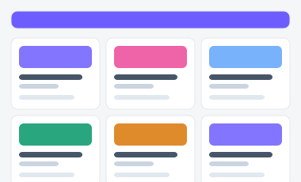

# 캠페인 목록 — 시안 2종

마케팅팀이 운영 중인 캠페인을 한눈에 관리하는 화면. "많은 캠페인을 빠르게 훑어보고 필터링"할지,
"몇 개 안 되는 캠페인을 시각적으로 강조해서 보여줄지"에 따라 접근이 달라져 두 시안을 준비했습니다.

| 시안 | 미리보기 | 특징 | 추천 상황 |
|---|---|---|---|
| **A — 표 중심** |  | 검색·상태·기간 필터 + StatCard 요약 + 데이터 표 | 운영 캠페인이 많고(10개+), 정렬·필터가 자주 필요할 때 |
| **B — 카드 그리드** |  | 채널별 색상 카드 + 진행률 바 | 캠페인 수가 적고, 진행 상황을 시각적으로 보고할 때 (경영 보고용) |

- 실제 파일: [`variant-a.html`](./variant-a.html) · [`variant-b.html`](./variant-b.html) — 브라우저로 직접 열람 가능 (빌드 불필요)
- 공용 스타일/스크립트: [`../components/tokens.css`](../components/tokens.css), [`../components/interactions.js`](../components/interactions.js)
- 부품 출처: [부품 6번 카드](../components/style-guide.html#s7), [17번 표](../components/style-guide.html#s17), [11번 드롭다운](../components/style-guide.html#s11)
