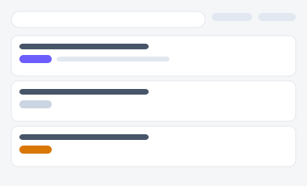
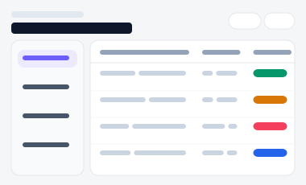
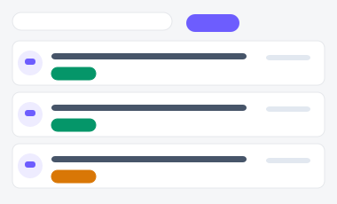

# 사내 통합 지식 검색 포털

전사 문서·위키·게시글을 찾는 3가지 서로 다른 방향성입니다(A/B/C). 각 시안은 진입 페이지(아래 링크)에서
시작해 실제로 여러 세부 화면을 오가며 동작합니다 — 검색·즐겨찾기·질문/답변은 브라우저에
실제로 저장되어(localStorage) 새로고침해도 유지됩니다.

| 시안 | 미리보기 | 방향성 | 세부 페이지 |
|---|---|---|---|
| [A](./variant-a.html) |  | **실무자 효율형** — 검색엔진 패턴. 빠르게 찾고 바로 나가는 것이 목표 | 홈 → [검색결과](./variant-a-results.html)(필터·페이지네이션 동작) → [문서상세](./variant-a-detail.html)(즐겨찾기 토글) → [즐겨찾기 목록](./variant-a-favorites.html) |
| [B](./variant-b.html) |  | **카테고리 탐색·에디토리얼형** — 부서함을 열어 들어가는 탐색, 문서는 잡지 기사처럼 넓게 | 홈(트리+표) → [문서상세](./variant-b-detail.html)(탭: 본문/버전이력/승인상태) → [신규 문서 등록](./variant-b-new.html) |
| [C](./variant-c.html) |  | **동료 Q&A 커뮤니티형** — 문서로 안 나오는 애매한 질문을 동료에게 직접 묻고 답하는 게시판 | 홈(인기/최신/미답변 정렬) → [질문상세](./variant-c-detail.html)(답변 작성·도움됨 추천·답변 채택 실동작) → [질문하기](./variant-c-new.html) |
| [D](./variant-d.html) |  | 개인화 홈 — 즐겨찾기·최근 본 문서 + 인기 문서 표(단일 화면 목업) |
