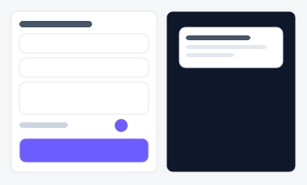
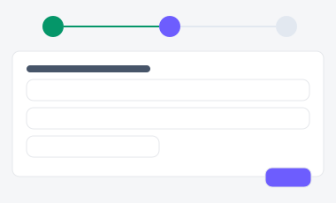
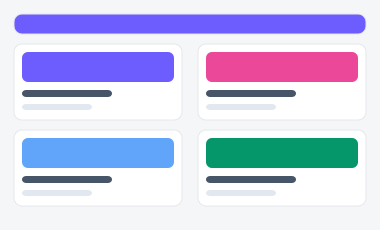

# 이메일/푸시 빌더 — 시안 3종

마케팅·CS팀이 이메일이나 앱 푸시를 작성해 발송하는 화면. "한 화면에서 다 보면서 작성"할지,
"단계별로 나눠 실수를 줄일지", "템플릿을 먼저 고르고 시작할지"에 따라 세 시안을 준비했습니다.

| 시안 | 미리보기 | 특징 | 추천 상황 |
|---|---|---|---|
| **A — 2단 분할형** |  | 좌측 폼 + 우측 실시간 미리보기 | 자주 쓰는 실무자가 빠르게 작성할 때 |
| **B — 3단계 위저드** |  | 콘텐츠 작성 → 대상 선택 → 예약 발송 | 처음 쓰는 사람도 순서대로 실수 없이 진행해야 할 때 |
| **C — 템플릿 갤러리** |  | 템플릿 카드를 먼저 선택 후 편집 | 이전에 쓰던 형식을 반복 재사용하는 팀 |

- 실제 파일: [`variant-a.html`](./variant-a.html) · [`variant-b.html`](./variant-b.html) · [`variant-c.html`](./variant-c.html) — 브라우저로 직접 열람 가능 (빌드 불필요)
- 공용 스타일/스크립트: [`../components/tokens.css`](../components/tokens.css), [`../components/interactions.js`](../components/interactions.js)
- 부품 출처: [부품 4번 폼](../components/style-guide.html#s4), [7번 카드(선택 가능)](../components/style-guide.html#s7), [11번 드롭다운](../components/style-guide.html#s11), [19번 스텝퍼](../components/style-guide.html#s19)
