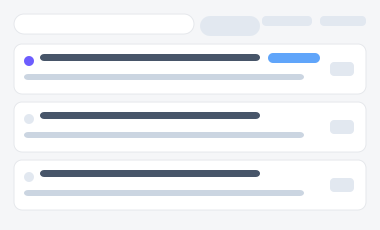

# 표준 업무 절차(SOP) · 매뉴얼 공유 포털

SOP·매뉴얼을 다루는 3가지 서로 다른 방향성입니다(A/B/C). 각 시안은 진입 페이지(아래 링크)에서
시작해 실제로 여러 세부 화면을 오가며 동작하고, 개정 요청·체크리스트 진행 상태는 브라우저에
실제로 저장되어(localStorage) 새로고침해도 유지됩니다.

| 시안 | 미리보기 | 방향성 | 세부 페이지 |
|---|---|---|---|
| [A](./variant-a.html) |  | **부서별 문서함 탐색형** — 부서 카드를 큰 진입점으로 배치, 처음 오는 사람도 헷갈리지 않게 | 홈(부서 카드 전환 동작) → [문서상세](./variant-a-detail.html) |
| [B](./variant-b.html) |  | **문서상세·개정관리형** — 본문/버전이력/승인상태를 탭으로 분리, 개정 요청 접수 가능 | 문서목록(검색) → [문서상세](./variant-b-detail.html)(탭) → [개정 요청](./variant-b-revise.html)(접수 시 승인상태 탭에 실제 반영) |
| [C](./variant-c.html) |  | **절차 실행·체크리스트형** — 문서가 아니라 "지금 수행 중"인 사람을 위한 실행형 | 홈(진행중 절차 목록) → [절차 실행](./variant-c-run.html)(체크 시 진행률 실시간 저장) → [완료 인증](./variant-c-complete.html) |
| [D](./variant-d.html) |  | 변경 알림 피드 — 구독 문서 개정 소식 스크롤 목록(단일 화면 목업) |
