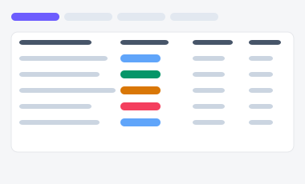
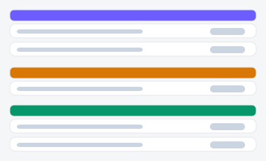
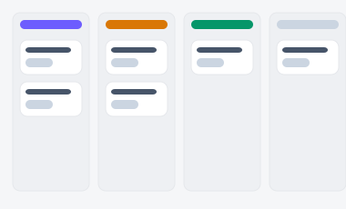

# 리드/고객 목록 — 시안 3종

영업팀이 담당 리드를 관리하는 화면. "전체를 표로 보고 단계는 필터로만 좁힐지",
"단계별로 그룹핑해 보여줄지", "칸반 보드로 직접 단계를 옮길지"에 따라 세 시안을 준비했습니다.

| 시안 | 미리보기 | 특징 | 추천 상황 |
|---|---|---|---|
| **A — 파이프라인 필터 + 표** |  | 필 탭으로 단계 필터링 + 정렬 가능한 표 | 리드 수가 많고(수십~수백 건), 정렬·검색이 중요할 때 |
| **B — 단계별 그룹 리스트** |  | 단계별로 묶어서 카드 리스트로 표시 | "단계별 분포"를 한눈에 보고 싶을 때 |
| **C — 칸반 보드** |  | 컬럼 = 단계, 카드 버튼으로 단계 이동 | 영업 담당자가 직접 리드를 다음 단계로 옮기며 관리할 때 |

- 실제 파일: [`variant-a.html`](./variant-a.html) · [`variant-b.html`](./variant-b.html) · [`variant-c.html`](./variant-c.html) — 브라우저로 직접 열람 가능 (빌드 불필요). C는 카드의 ‹ › 버튼을 눌러 실제로 컬럼 간 이동해볼 수 있습니다.
- 공용 스타일/스크립트: [`../components/tokens.css`](../components/tokens.css), [`../components/interactions.js`](../components/interactions.js)
- 부품 출처: [부품 6번 배지·칩](../components/style-guide.html#s6), [8번 필 탭](../components/style-guide.html#s8), [9번 아코디언](../components/style-guide.html#s9)
- 참고: C의 칸반은 드래그앤드롭이 아니라 버튼 클릭으로 이동합니다 — 실제 드래그 인터랙션은 별도 구현이 필요합니다.
