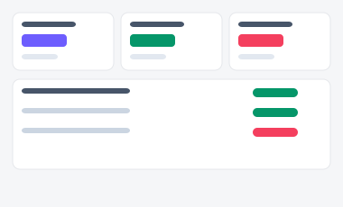
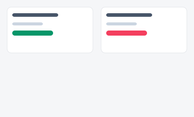
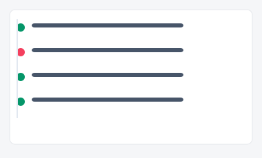
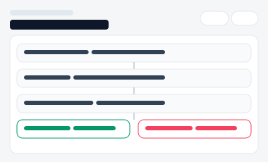

# RPA 기반 반복 업무 자동화 대시보드

자동화를 관리하는 3가지 서로 다른 방향성입니다(A/B/C).

| 시안 | 미리보기 | 방향성 | 화면 구성 |
|---|---|---|---|
| [A](./variant-a.html) |  | **관리자 운영 대시보드형** — 전체 자동화의 성공/실패 현황을 한눈에 | 홈(StatCard+표) → [자동화상세](./variant-a-detail.html)(on/off 전환, 실행이력) |
| [B](./variant-b.html) |  | **담당자 카드형** — 내가 담당하는 자동화 몇 개를 카드로 직접 관리 | 홈(카드+토글) → [자동화상세](./variant-b-detail.html)(지금 바로 실행) → [새 자동화 등록](./variant-b-new.html) |
| [C](./variant-c.html) |  | **실행로그 타임라인형** — 방금 무슨 일이 있었는지 순서가 중요한 운영/장애 대응 | 홈(실패만 보기 필터) → [로그상세](./variant-c-detail.html)(재시도 실행) |
| [D](./variant-d.html) |  | 자동화 빌더 — 단계 블록 조립 + 성공/실패 분기 |
