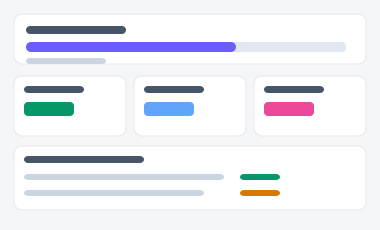
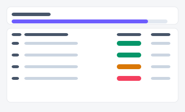

# 영업 목표 달성 현황 — 시안 2종

영업 담당자·팀장이 목표 대비 실적을 확인하는 화면. "내 개인 실적 중심"으로 볼지,
"팀 전체와 팀원 순위 중심"으로 볼지에 따라 두 시안을 준비했습니다.

| 시안 | 미리보기 | 특징 | 추천 상황 |
|---|---|---|---|
| **A — 개인 중심** |  | 내 목표 진행바 + 실적 StatCard + 최근 활동 타임라인 | 영업 담당자 개인용 대시보드 |
| **B — 팀 비교 중심** |  | 팀 목표 진행바 + 팀원별 순위 표 | 팀장이 주간 회의에서 띄워놓고 보는 화면 |

- 실제 파일: [`variant-a.html`](./variant-a.html) · [`variant-b.html`](./variant-b.html) — 브라우저로 직접 열람 가능 (빌드 불필요)
- 공용 스타일/스크립트: [`../components/tokens.css`](../components/tokens.css), [`../components/interactions.js`](../components/interactions.js)
- 부품 출처: [부품 19번 진행바](../components/style-guide.html#s19), [9번 아코디언](../components/style-guide.html#s9), [17번 표](../components/style-guide.html#s17)
