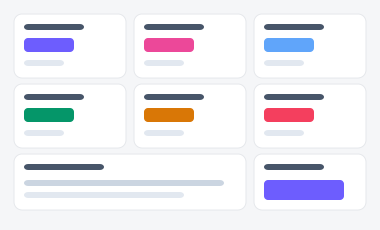
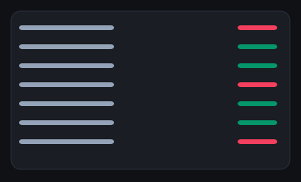

# 경영 종합 대시보드 — 시안 3종

경영진이 회사 전체 핵심 지표를 확인하는 화면. "지표를 다 펼쳐놓을지", "영역별 탭으로 볼지",
"운영 모니터링 콘솔처럼 조밀하게 볼지"에 따라 세 시안을 준비했습니다.

| 시안 | 미리보기 | 특징 | 추천 상황 |
|---|---|---|---|
| **A — KPI 그리드형** |  | StatCard 6개 + 부서별 표 + 빠른 링크 | 매일 아침 한 번 훑고 지나가는 요약형 화면 |
| **B — 탭 분할형** |  | 매출/사용자/운영 탭으로 영역별 심층 확인 | 지표가 많아 한 화면에 담기 부담스러울 때 |
| **C — 모니터링 콘솔형** |  | 모노스페이스 숫자 + 미니 스파크라인, 다크 우선 | 운영 담당자가 이상 수치를 빠르게 스캔해야 할 때 |

- 실제 파일: [`variant-a.html`](./variant-a.html) · [`variant-b.html`](./variant-b.html) · [`variant-c.html`](./variant-c.html) — 브라우저로 직접 열람 가능 (빌드 불필요). C는 우측 상단 🌙 버튼으로 다크모드를 켜면 의도한 분위기가 드러납니다.
- 공용 스타일/스크립트: [`../components/tokens.css`](../components/tokens.css), [`../components/interactions.js`](../components/interactions.js)
- 부품 출처: [부품 7번 StatCard](../components/style-guide.html#s7), [8번 탭](../components/style-guide.html#s8), [14번 배너](../components/style-guide.html#s14)
