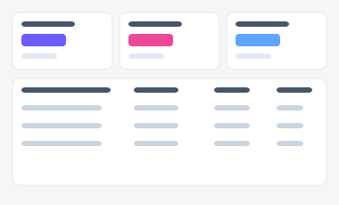
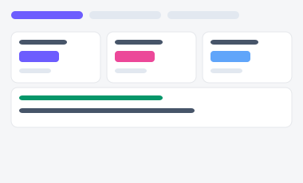
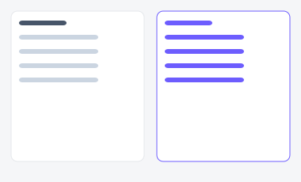

# 캠페인 성과 리포트 — 시안 3종

마케팅팀이 캠페인 성과를 정기적으로 확인·보고하는 화면. "표로 세밀하게 볼지", "캠페인별 탭으로
하나씩 깊게 볼지", "지난 기간과 나란히 비교할지"에 따라 세 시안을 준비했습니다.

| 시안 | 미리보기 | 특징 | 추천 상황 |
|---|---|---|---|
| **A — KPI + 채널별 표** |  | 핵심 KPI 4개 + 채널별 세부 표 | 정기 보고서와 가장 가까운 정통 구성 |
| **B — 캠페인별 탭** |  | 탭으로 캠페인 전환, 캠페인마다 KPI+인사이트 배너 | 캠페인 수는 적지만(3~5개) 각각 상세히 봐야 할 때 |
| **C — 기간 비교** |  | 이번 달 vs 지난 달 2열 비교 | "지난달보다 좋아졌는지"가 핵심 질문일 때 |

- 실제 파일: [`variant-a.html`](./variant-a.html) · [`variant-b.html`](./variant-b.html) · [`variant-c.html`](./variant-c.html) — 브라우저로 직접 열람 가능 (빌드 불필요)
- 공용 스타일/스크립트: [`../components/tokens.css`](../components/tokens.css), [`../components/interactions.js`](../components/interactions.js)
- 부품 출처: [부품 7번 StatCard](../components/style-guide.html#s7), [8번 탭](../components/style-guide.html#s8), [14번 배너](../components/style-guide.html#s14)
