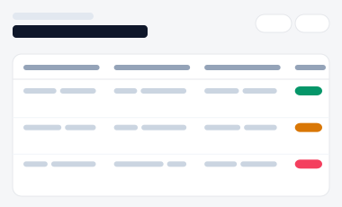

# 사내 데이터 허브·정제 관리 포털

전사 데이터셋을 다루는 3가지 서로 다른 방향성입니다(A/B/C). 각 시안은 진입 페이지(아래 링크)에서
시작해 실제로 여러 세부 화면을 오가며 동작합니다 — 접근 신청·정합성 해결 상태는 브라우저에
실제로 저장되어(localStorage) 새로고침해도 유지됩니다.

| 시안 | 미리보기 | 방향성 | 세부 페이지 |
|---|---|---|---|
| [A](./variant-a.html) |  | **카탈로그 검색표형(분석가용)** — "어떤 데이터가 있는지" 탐색하는 가장 빠른 진입 | 홈(검색·부서 필터 실동작) → [데이터셋상세](./variant-a-detail.html)(접근 신청 실제 저장) |
| [B](./variant-b.html) |  | **스키마·샘플·계보 탭 상세형** — 하나의 데이터셋을 깊이 파악 | 목록 → [데이터셋상세](./variant-b-detail.html)(탭: 스키마/샘플/계보, 계보에서 관련 데이터셋으로 이동) |
| [C](./variant-c.html) |  | **품질 점수·정합성 체크리스트형(거버넌스 담당자용)** — "품질이 괜찮은지"가 우선 관심사 | 홈(이슈 데이터셋 목록) → [정합성검사](./variant-c-detail.html)(항목 해결 처리 실제 저장, 홈 이슈 건수에 반영) |
| [D](./variant-d.html) |  | 접근 권한 신청 — 신청자별 승인 상태 표(단일 화면 목업) |
