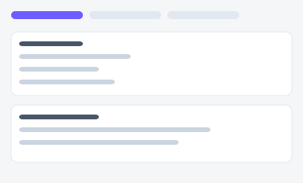
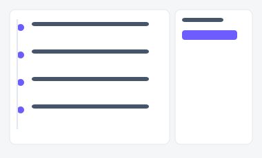
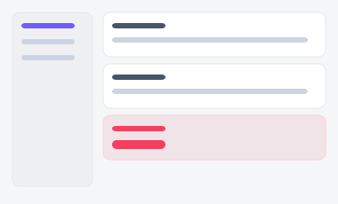

# 리드 상세 — 시안 3종

영업 담당자가 리드 한 건을 깊이 들여다보는 화면. "탭으로 나눠 볼지", "활동 타임라인을
중심으로 볼지", "탭 없이 쭉 스크롤하며 볼지"에 따라 세 시안을 준비했습니다.

| 시안 | 미리보기 | 특징 | 추천 상황 |
|---|---|---|---|
| **A — 탭 기반** |  | 기본정보/활동/메모 탭 분리 | 정보량이 많아도 화면이 길어지지 않게 하고 싶을 때 |
| **B — 타임라인 중심** |  | 세로 타임라인 + 사이드 요약 카드 | "지금까지 무슨 일이 있었는지" 흐름이 중요할 때 |
| **C — 단일 스크롤 + 앵커** |  | 전 섹션을 세로로 나열, 좌측 앵커로 점프 | 탭 뒤에 숨기지 않고 Ctrl+F 검색이 되게 하고 싶을 때 |

- 실제 파일: [`variant-a.html`](./variant-a.html) · [`variant-b.html`](./variant-b.html) · [`variant-c.html`](./variant-c.html) — 브라우저로 직접 열람 가능 (빌드 불필요)
- 공용 스타일/스크립트: [`../components/tokens.css`](../components/tokens.css), [`../components/interactions.js`](../components/interactions.js)
- 부품 출처: [부품 8번 탭](../components/style-guide.html#s8), [9번 아코디언](../components/style-guide.html#s9), [10번 브레드크럼](../components/style-guide.html#s10)
