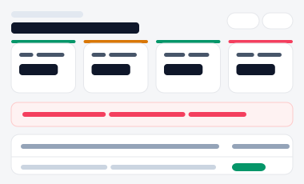
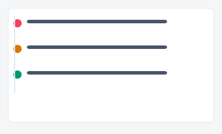
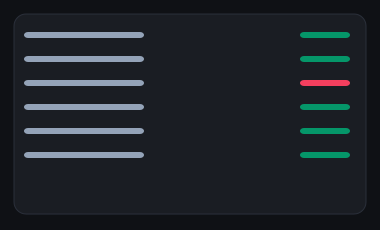
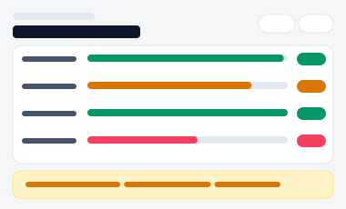

# 시스템 성능·운영 모니터링 대시보드

시스템 운영 상태를 다루는 3가지 서로 다른 방향성입니다(A/B/C). 각 시안은 진입 페이지(아래 링크)에서
시작해 실제로 여러 세부 화면을 오가며 동작합니다 — 확인 처리·해결 처리·임계치 설정은
브라우저에 실제로 저장되어(localStorage) 새로고침해도 유지됩니다.

| 시안 | 미리보기 | 방향성 | 세부 페이지 |
|---|---|---|---|
| [A](./variant-a.html) |  | **서비스 상태 상황판형** — 여러 서비스를 동시에 감시하는 상황판 | 홈(카드) → [서비스상세](./variant-a-detail.html)(장애 확인 처리 실제 저장) |
| [B](./variant-b.html) |  | **인시던트 이력 타임라인형(포스트모템용)** — 무슨 일이 있었고 어떻게 대응했는지 | 홈(타임라인) → [인시던트상세](./variant-b-detail.html)(원인·조치 확인, 해결 처리 실제 저장) |
| [C](./variant-c.html) |  | **모니터링 콘솔형(SRE·인프라 담당자용)** — 모노스페이스+스파크라인으로 빠른 스캔 | 홈(지표 나열) → [지표상세](./variant-c-detail.html)(알림 임계치 직접 설정, 실제 저장) |
| [D](./variant-d.html) |  | SLA 리포트 — 서비스별 월간 가동률 막대 비교(단일 화면 목업) |
