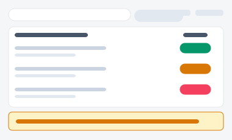

# IT 서비스·보안 컴플라이언스 체크리스트 포털

보안·컴플라이언스를 다루는 3가지 서로 다른 방향성입니다(A/B/C). 각 시안은 진입 페이지(아래 링크)에서
시작해 실제로 여러 세부 화면을 오가며 동작합니다 — 점검 완료·코멘트·증적 등록은 브라우저에
실제로 저장되어(localStorage) 새로고침해도 유지됩니다.

| 시안 | 미리보기 | 방향성 | 세부 페이지 |
|---|---|---|---|
| [A](./variant-a.html) |  | **실행형 체크리스트(점검·감사 실무자용)** — 오늘 뭘 확인해야 하는지 순서대로 처리 | 홈(체크 클릭 시 완료 전환 실동작) → [코멘트](./variant-a-detail.html)(항목별 기록 실제 저장) |
| [B](./variant-b.html) |  | **부서별 준수율 비교 대시보드형(경영진·감사팀 보고용)** — 어느 부서가 취약한지 파악 | 홈(부서 카드) → [부서상세](./variant-b-detail.html)(미조치 항목 확인) |
| [C](./variant-c.html) |  | **감사 증적 관리 표형** — "증거 자료가 있는지"가 핵심인 외부 감사 대응 | 홈(표) → [증적상세](./variant-c-detail.html)(증적 등록 시 상태가 실제로 완료 전환) |
| [D](./variant-d.html) |  | 정책 서명 현황 — 문서 버전별 서명 완료율 표(단일 화면 목업) |
