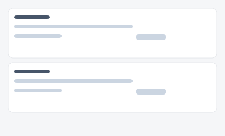
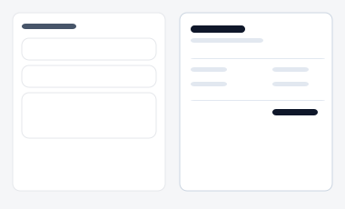

# 견적서 작성 — 시안 3종

영업팀이 고객에게 보낼 견적서를 작성하는 화면. "표처럼 반복 입력할지", "카드로 하나씩
입력할지", "완성될 문서를 실시간으로 보며 입력할지"에 따라 세 시안을 준비했습니다.

| 시안 | 미리보기 | 특징 | 추천 상황 |
|---|---|---|---|
| **A — 반복 입력행** |  | 품목을 표처럼 반복 입력 + 합계 자동 계산 | 품목이 많을 때(10줄+) 가장 빠른 입력 |
| **B — 카드형 품목** |  | 품목마다 카드로 분리 | 좁은 화면(태블릿·모바일)에서 입력할 때 |
| **C — 실시간 미리보기** |  | 좌측 입력, 우측 실제 문서 형태 미리보기 | 고객에게 보낼 최종 모습을 확인하며 작성할 때 |

- 실제 파일: [`variant-a.html`](./variant-a.html) · [`variant-b.html`](./variant-b.html) · [`variant-c.html`](./variant-c.html) — 브라우저로 직접 열람 가능 (빌드 불필요). A는 수량/단가를 바꾸면 합계가 실시간으로 재계산됩니다.
- 공용 스타일/스크립트: [`../components/tokens.css`](../components/tokens.css), [`../components/interactions.js`](../components/interactions.js)
- 부품 출처: [부품 4번 폼](../components/style-guide.html#s4) + 이 폴더군 전용 반복 입력행(`item-row`, `tokens.css`에 추가)
