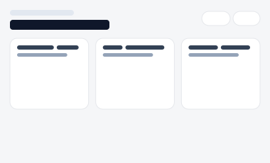
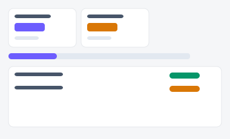
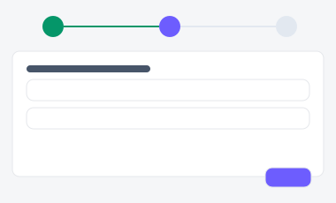
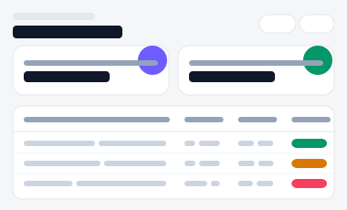

# B2B 서비스 구독·PoC 샌드박스 포털

B2B 파트너사 대응을 다루는 3가지 서로 다른 방향성입니다(A/B/C).

| 시안 | 미리보기 | 방향성 | 화면 구성 |
|---|---|---|---|
| [A](./variant-a.html) |  | **서비스 카탈로그 선택 카드형(도입 검토용)** — 가격·플랜 비교가 핵심인 SaaS 랜딩 패턴 | 홈(카탈로그) → [서비스상세](./variant-a-detail.html)(PoC 신청) |
| [B](./variant-b.html) |  | **내 샌드박스 운영 대시보드형** — 이미 도입 중인 파트너사의 운영 현황 확인 | 홈(표) → [환경상세](./variant-b-detail.html)(PoC 연장 요청) |
| [C](./variant-c.html) |  | **3단계 신청 위저드형** — 계약·승인이 필요한 절차를 단계별로 안내 | 위저드(서비스선택→환경설정→승인요청) → [내 신청 내역](./variant-c-list.html) |
| [D](./variant-d.html) |  | 구독·청구 내역 — 요금제별 청구액·다음 결제일 표 |
