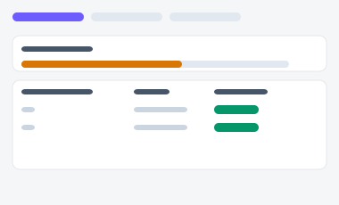
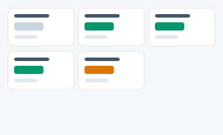
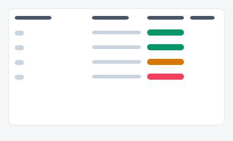

# 팀별 성과 대시보드 — 시안 3종

경영진·팀장이 여러 팀의 성과를 비교하는 화면. "탭으로 팀을 전환할지", "팀 카드를 나란히
비교할지", "전사 랭킹표 하나로 통합할지"에 따라 세 시안을 준비했습니다.

| 시안 | 미리보기 | 특징 | 추천 상황 |
|---|---|---|---|
| **A — 팀 전환 탭** |  | 탭으로 팀 전환 + 팀별 순위 표 | 팀 수가 많아도(5개+) 화면이 늘어지지 않게 |
| **B — 팀 카드 비교** |  | 모든 팀을 카드로 나란히 배치 | 팀 수가 적을 때(3~5개) 클릭 없이 바로 비교 |
| **C — 전사 랭킹** |  | 팀을 하나의 랭킹표로 통합 + 순위 변동 표시 | 부서 간 경쟁을 강하게 드러내고 싶을 때 |

- 실제 파일: [`variant-a.html`](./variant-a.html) · [`variant-b.html`](./variant-b.html) · [`variant-c.html`](./variant-c.html) — 브라우저로 직접 열람 가능 (빌드 불필요)
- 공용 스타일/스크립트: [`../components/tokens.css`](../components/tokens.css), [`../components/interactions.js`](../components/interactions.js)
- 부품 출처: [부품 8번 탭](../components/style-guide.html#s8), [17번 표](../components/style-guide.html#s17), [19번 진행바](../components/style-guide.html#s19)
