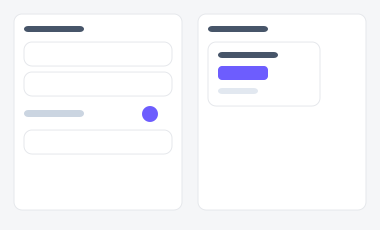
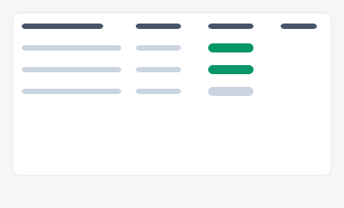
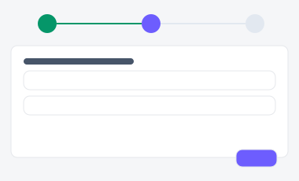

# 리포트 예약/내보내기 — 시안 3종

정기 리포트를 설정하고 관리하는 화면. "필터+미리보기로 처음 설정할지", "이미 만든 예약들을
목록으로 관리할지", "단계별 위저드로 처음 쓰는 사람을 안내할지"에 따라 세 시안을 준비했습니다.

| 시안 | 미리보기 | 특징 | 추천 상황 |
|---|---|---|---|
| **A — 필터 + 미리보기** |  | 필터 설정 즉시 우측에 미리보기 | 리포트를 처음 설정할 때 가장 직관적 |
| **B — 예약 목록 관리** |  | 이미 예약된 리포트들을 표로 관리 | 리포트를 여러 개 운영하며 "뭐가 언제 나가는지" 관리할 때 |
| **C — 3단계 위저드** |  | 데이터 선택 → 형식 선택 → 예약 설정 | 처음 쓰는 사람이 순서대로 따라가도록 유도할 때 |

- 실제 파일: [`variant-a.html`](./variant-a.html) · [`variant-b.html`](./variant-b.html) · [`variant-c.html`](./variant-c.html) — 브라우저로 직접 열람 가능 (빌드 불필요)
- 공용 스타일/스크립트: [`../components/tokens.css`](../components/tokens.css), [`../components/interactions.js`](../components/interactions.js)
- 부품 출처: [부품 4번 폼](../components/style-guide.html#s4), [7번 카드](../components/style-guide.html#s7), [19번 스텝퍼](../components/style-guide.html#s19)
