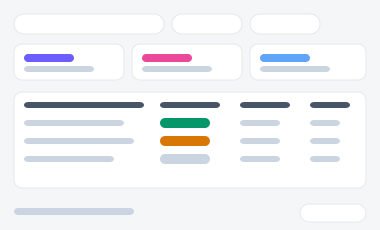
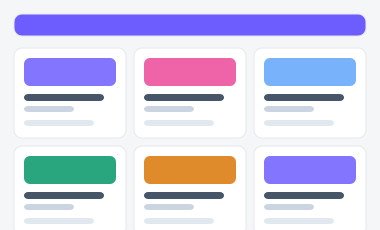
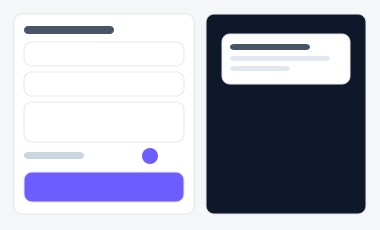
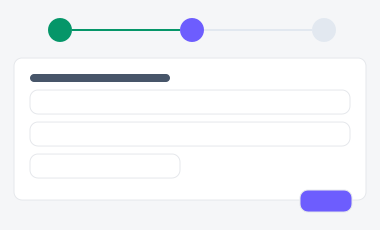
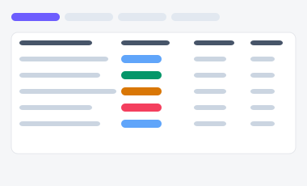
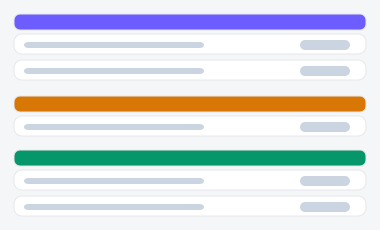
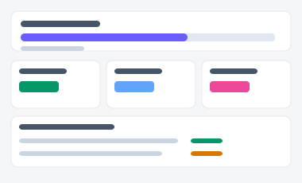
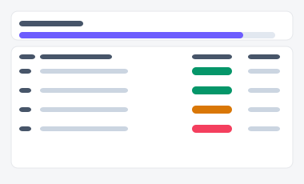
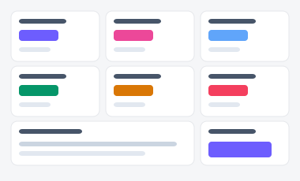
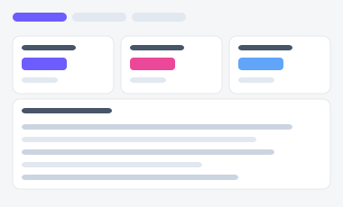

# ICONIA Admin — UI/UX 디자인 시안 전달 문서

> 목적: 이미 구현된 ICONIA 운영 콘솔(Next.js 웹앱)의 UI/UX를 디자이너·기획자·클라이언트에게
> 공유하기 위한 전달용 문서입니다. **기능(메뉴 그룹) 단위로 묶고, 그 안을 페이지 단위로
> 나누는 하이브리드 구조**를 따릅니다 — 실제 사이드바 메뉴 구조(`app/dashboard/Sidebar.tsx`)를
> 그대로 섹션 순서로 사용해, 개발 구조와 전달 문서 구조가 어긋나지 않도록 했습니다.
>
> 함께 보면 좋은 자료: [`components/style-guide.html`](./components/style-guide.html) —
> **20개 카테고리**로 정리한 인터랙티브 스타일 가이드 + 완성 페이지 예시(P1~P5). 프레임워크
> 없이 바닐라 JS로 대부분 실제 클릭 가능한 동작 데모이며, 다크모드 토글을 지원합니다
> (브라우저에서 바로 열람 가능, 빌드 불필요). 자세한 20종 목록은 §1.4 참고.

---

## 폴더 구성 (총 6개) — 어디부터 볼지

이 저장소는 **부품 폴더 1개 + 주제(시안) 폴더 5개**, 총 6개 폴더로 구성됩니다. 순서는
**components → 관심 있는 주제 폴더** 입니다: 부품을 먼저 보면 주제 폴더의 화면이 어떤
조각으로 조립됐는지 바로 이해가 됩니다.

### 📦 부품 (1개 폴더)

| 폴더 | 내용 |
|---|---|
| [`components/`](./components/) | 20개 카테고리 인터랙티브 카탈로그 + 5개 주제 폴더가 공유하는 `tokens.css`/`interactions.js` |

### 🎨 주제별 시안 (5개 폴더 · 폴더당 2개 시안)

| 폴더 | 주제 | 시안 A | 시안 B |
|---|---|---|---|
| [`01-campaign-list/`](./01-campaign-list/) | 마케팅 · 캠페인 목록 |  표 중심 |  카드 그리드 |
| [`02-email-push-builder/`](./02-email-push-builder/) | 마케팅 · 이메일/푸시 빌더 |  2단 분할형 |  3단계 위저드 |
| [`03-lead-list/`](./03-lead-list/) | 영업 · 리드/고객 목록 |  파이프라인 필터+표 |  단계별 그룹 리스트 |
| [`04-sales-goal-dashboard/`](./04-sales-goal-dashboard/) | 영업 · 목표 달성 현황 |  개인 중심 |  팀 비교 중심 |
| [`05-executive-dashboard/`](./05-executive-dashboard/) | 대시보드 · 경영 종합 |  KPI 그리드형 |  탭 분할형 |

각 폴더를 열면 `README.md`에 두 시안의 미리보기와 "언제 어떤 시안을 쓰면 좋은지"가 정리돼
있고, `variant-a.html`/`variant-b.html`을 브라우저로 직접 열면 실제 동작(클릭 가능한 버튼,
탭, 드롭다운 등)까지 확인할 수 있습니다. 미리보기 이미지는 실제 화면을 렌더링한 스크린샷이
아니라 레이아웃을 요약한 와이어프레임 SVG입니다 — 정확한 모습은 반드시 `.html` 파일을 열어
확인하세요.

> 남은 10개 주제(P6 이후, 결제·리포트 등)는 아직 시안을 만들지 않았습니다. 다음 배치로
> 진행할 주제를 알려주시면 같은 방식(폴더 + 시안 2개 + README + 미리보기)으로 추가합니다.

---

## 0. 개요

| 항목 | 내용 |
|---|---|
| 서비스 | ICONIA Operator / CS / SRE 운영 콘솔 |
| 형태 | Next.js 15 (App Router) + Tailwind CSS, 서버 컴포넌트 중심 |
| 대상 사용자 | 운영자(Operator), CS 담당자, SRE — 역할별 RBAC로 메뉴 노출 제어 |
| 인증 | 이메일/비밀번호 로그인 + 2FA(TOTP + 백업 코드) |
| 화면 수 | 사이드바 노출 20+ / 히든(직접 URL) 포함 40+ 라우트 |

### 사이트맵 (기능 그룹 → 페이지)

```
로그인 · 인증
├─ 로그인                         /login
└─ 2FA 등록 · 백업 코드           /security/2fa

대시보드 홈                        /dashboard

[그룹] 사용자 · 디바이스
├─ 사용자 조회 (360)              /dashboard/user-360
├─ 회원 관리                      /dashboard/users
│   └─ 회원 추가                  /dashboard/users/new
│   └─ 사용자 권리 큐             /dashboard/users/rights
├─ CS 통합 조회                   /dashboard/cs
├─ 디바이스 모니터링              /dashboard/devices
├─ OTA 배포                       /dashboard/ota-deploy
├─ 양산 · 출고 검수               /dashboard/factory-test
└─ AS · 교환 관리                 /dashboard/as

[그룹] 콘텐츠 · 모더레이션
├─ 콘텐츠 관리 (아코디언)         /dashboard/content
│   ├─ 피드                       /dashboard/feed (+ /feed/new)
│   ├─ 커머스                     /dashboard/content/commerce
│   └─ 도감                       /dashboard/content/catalog
├─ 모더레이션 (배지)              /dashboard/moderation
├─ 분실 · 도난 신고               /dashboard/lost-reports
├─ FAQ 관리                       /dashboard/info/faqs
└─ 공지 · 푸시 관리                /dashboard/notice-push

[그룹] AI 운영
├─ AI Key 관리                    /dashboard/gemini
├─ AI 페르소나                    /dashboard/personas
└─ 기능 플래그                    /dashboard/feature-flags

[그룹] 시스템 · 운영
├─ 오류 추적                      /dashboard/error-tracking
├─ 운영 안정성 (아코디언)         /dashboard/ops
│   ├─ 로그 검색                  /dashboard/ops/logs
│   ├─ 감사 로그                  /dashboard/ops/audit
│   ├─ 장애 Runbook               /dashboard/ops/runbook
│   └─ Seed 상태                  /dashboard/ops/seed
└─ 운영자 관리                    /dashboard/operators

[히든 — 직접 URL만 지원]
IP 허용목록 · 커머스 배너/주문 · 에러 3종(서버/앱/펌웨어) ·
AI/BYOK 사용량 · 약관 관리 등 (표 2-6 참고)
```

이 사이트맵은 코드에서 자동 생성된 것이 아니라 실제 `navGroups` 선언을 옮긴 것이므로,
라우트가 바뀌면 이 문서도 함께 갱신해야 합니다.

---

## 1. 디자인 시스템 (Foundation)

실제 `tailwind.config.js`에 정의된 토큰 그대로입니다. 임의로 지어낸 값이 아니라
지금 화면에 적용 중인 값입니다.

### 1.1 컬러

| 토큰 | 값 | 용도 |
|---|---|---|
| `accent` | `#6D5DFE` | 브랜드 프라이머리 — 활성 네비, 프라이머리 버튼, 포커스 링 |
| `accentPink` | `#EC4899` | 보조 강조 (StatCard 그라데이션 등) |
| `accentBlue` | `#60A5FA` | 보조 강조 |
| `accentOrange` | `#F97316` | 보조 강조 / 경고성 하이라이트 |
| `accentTeal` | `#14B8A6` | 보조 강조 |
| `canvas` | `#F5F6F8` | 페이지 배경 |
| `surface` | `#FFFFFF` | 카드 · 사이드바 배경 |
| `hairline` | `#E5E7EB` | 1px 보더 |
| `rose-500/700` | Tailwind 기본 | 위험 상태 (모더레이션 미해결 배지 등) |

디자인 톤: **NCP/NAVER Works 스타일의 라이트 어드민** — 흰 사이드바 + 흰 톱바 + 연회색
캔버스, 카드에 미세한 그림자(`shadow-card`)만 사용. 예전에 검토했던 다크 사이드바 +
MUI 블루 리스킨 안(`docs/2026-05-18-mui-redesign-plan.md`)은 폐기되었고, 현재는
Tailwind 기반 라이트 테마로 확정되어 있습니다 — 시안 전달 시 혼선이 없도록 과거 문서는
"폐기된 안"으로 표시해 두었습니다.

### 1.2 타이포그래피 / 형태

| 토큰 | 값 |
|---|---|
| 카드 radius | `xl` 12px / `2xl` 16px |
| 버튼 radius | 8–10px (컴포넌트별 `rounded-lg` 사용) |
| 카드 그림자 | `shadow-card` — `0 1px 2px rgba(15,23,42,.04), 0 1px 3px rgba(15,23,42,.06)` |
| 강조 그림자 | `shadow-soft` — `0 6px 18px rgba(109,93,254,.18)` (프라이머리 버튼 글로우) |
| 본문 텍스트 | `text-slate-900` (제목) / `text-slate-600` (본문) / `text-muted` (보조) |

### 1.3 공통 컴포넌트 (`app/dashboard/_components/`)

| 컴포넌트 | 역할 | 시안에 포함할 상태 |
|---|---|---|
| `PanelCard` | 섹션 컨테이너 (title + description + actions + children) | 기본 / actions 유무 |
| `StatCard` | KPI 요약 카드 (accent 5색, delta 방향 up/down/flat) | 5개 accent × 3개 delta tone |
| `KpiChip` / `KpiSparkline` | 작은 지표 칩 + 스파크라인 | 기본 |
| `DataTable` | 전 대시보드 공용 표 — 클라이언트 페이지네이션(기본 25행) 내장, 커서 페이지네이션 지원 | **empty**, 로딩, 페이지네이션 바 유무, 커서 다음/이전 |
| `ExpandableRow` | 표 행 확장 | 접힘 / 펼침 |
| `DangerConfirmDialog` | 파괴적 작업 확인 모달 (강제 로그아웃, 계정 잠금 등) | 기본 / 사유 입력 필수형 |
| `ForbiddenNotice` | RBAC 권한 없음 안내 | — |
| `AdminToast` | 성공/실패 토스트 | success / error |
| `TopbarRich` | 페이지 타이틀 + 부제 + 프로필 칩 + 모바일 메뉴 버튼 | 데스크탑 / 모바일 |
| `Sidebar` + `NavMenu` | 4개 그룹 아코디언 네비, RBAC로 항목 숨김, 모더레이션 배지 | 데스크탑 고정 / 모바일 드로어 |

> 시안 문서에는 이 표에 있는 컴포넌트들의 상태(empty, loading, error, disabled)를
> 반드시 스크린샷으로 포함하세요 — 실제 리뷰에서 가장 많이 나오는 질문이 "빈 화면/에러일 때는
> 어떻게 보이나요?" 입니다.

### 1.4 스타일 가이드 20종 (`style-guide.html`)

전역 유틸리티 클래스와 컴포넌트를 **20개 카테고리**로 묶고, 각 번호 아래에 세부 항목을
나열했습니다. **적용중**은 `app/globals.css` / `app/dashboard/_components/`에 실제로 있는
스타일, **제안**은 아직 앱엔 없지만 일반 웹앱에서 널리 쓰여서 이 문서가 새로 더한 패턴입니다.
"(클릭)" 표시가 있는 항목은 `style-guide.html`에서 실제로 눌러 동작을 확인할 수 있습니다.

**1. 컬러 토큰** (적용중) — 브랜드 accent 5색 · 서피스/시맨틱 5색 · 텍스트 대비 페어 3종

**2. 타이포그래피 · 스페이싱** (적용중) — H1~H3 · Body · Caption · Overline · Mono · radius 스케일 · shadow 3종

**3. 버튼** (적용중) — 기본 3종(클릭 시 로딩) · 고스트 · 링크 · 비활성 · 크기 4단(xs/sm/md/lg) · 아이콘 전용(클릭 시 회전) · 버튼 그룹/세그먼트(클릭 전환) · 전체너비

**4. 폼 입력** (적용중) — 검색+Clear(X, 클릭) · 비밀번호 보기/숨기기(클릭) · 셀렉트 · 텍스트에어리어 · 읽기전용 · 비활성 · 숫자 스테퍼(클릭 증감) · 파일 업로드(클릭 상태 전환)

**5. 체크박스 · 라디오 · 토글** (적용중) — 3단 체크 indeterminate(클릭 순환) · 라디오 그룹 · 전체선택→자식 연동(클릭) · 토글 스위치 2종(클릭 on/off)

**6. 배지 · 칩** (적용중) — 상태 칩 5색 · 아웃라인 칩 · 제거 가능 칩(X 클릭 시 삭제) · 카운트 배지 2종

**7. 카드** (적용중) — glass-card/glass-panel · StatCard 3색 · 선택 가능 카드(클릭 시 체크) · 이미지 헤더 카드

**8. 탭** (적용중) — 가로 탭(클릭 전환) · 필 탭(pill, 클릭) · 세로 탭(클릭)

**9. 아코디언 / 펼침 행** (적용중) — 단일 펼침(클릭) · 그룹 아코디언(하나 열면 나머지 자동 접힘) · FAQ +/− 스타일(클릭)

**10. 브레드크럼** (제안) — 기본+홈 아이콘 · 긴 경로 축약("…" 클릭 시 펼침)

**11. 드롭다운 메뉴** (제안) — 기본 액션 메뉴 · 체크박스 필터 드롭다운(선택 개수 실시간 표시) · 프로필 아바타 메뉴, 모두 바깥 클릭 시 자동 닫힘

**12. 툴팁** (제안) — 상/하/좌/우 4방향 · 아이콘 트리거, 순수 CSS(hover/focus)

**13. 내비게이션** (적용중) — 사이드바(클릭 시 active 전환) · 상단 탭바(클릭) · 모바일 하단 내비(클릭)

**14. 배너 · 알림** (적용중) — 정보/성공/경고/에러 4톤 · 닫기 가능 · 재시도 액션(클릭 시 로딩→성공 전환)

**15. 스낵바 · 토스트** (적용중+제안) — 정보/성공/경고/에러 4톤 · **로딩→완료 전환** · **실행취소(undo)+X 닫기** · 액션 버튼(보기) 포함 · 여러 개 동시 스택 · 위치 전환(하단⇄상단), 전부 클릭으로 실행

**16. 모달 / 확인 다이얼로그** (적용중) — danger/primary 확인 · 문구 입력 확인형("DELETE" 입력해야 버튼 활성화) · 우측 드로어(슬라이드), ESC로 닫기 지원

**17. 표 · 페이지네이션** (적용중) — 정렬 가능 헤더(클릭 시 오름/내림 실제 정렬) · 행 선택+전체선택(클릭 시 상단 바에 선택 개수 표시) · 페이지네이션

**18. 스켈레톤 · 시머 이펙트** (제안) — 아바타+텍스트(클릭 시 로드완료 전환) · 카드형 · 표 행형

**19. 진행 표시줄 · 스텝퍼** (제안) — 결정형 진행바(클릭으로 %지정) · 비결정형(인디터미닛) 진행바 · 스텝퍼(단계 클릭 시 이동)

**20. 상태 · 유틸리티** (적용중) — empty/loading/error/forbidden 4종 · 클립보드 복사(클릭) · 인쇄(클릭 시 브라우저 인쇄창) · 키보드 포커스 링(Tab 이동 데모)

### 1.5 구현 기준 — TypeScript · Tailwind CSS · HTML

`style-guide.html`은 **브라우저에서 빌드 없이 바로 열람**할 수 있도록 순수 CSS + 바닐라 JS로
작성된 **미리보기 전용 문서**입니다. 실제 코드로 옮길 때는 이 레포의 기존 스택을 그대로
따릅니다 — 새 라이브러리나 CSS-in-JS를 도입하지 않습니다.

| 구분 | 기준 | 비고 |
|---|---|---|
| 언어 | **TypeScript** (`.tsx`) | `app/dashboard/_components/*.tsx`와 동일한 함수형 컴포넌트 + named export 패턴 |
| 스타일 | **Tailwind CSS** 유틸리티 클래스 | 새 CSS 파일을 만들지 않고 클래스명으로 표현. 반복되는 조합만 `app/globals.css`의 `@layer components`에 `.btn-*`/`.chip-*`처럼 추가 |
| 마크업 | **HTML(JSX)** 시맨틱 요소 | `role="dialog"`/`role="switch"`/`role="tablist"` 등 이 문서의 접근성 속성을 그대로 유지 |
| 상태 | React `useState`/`useTransition` | 데모의 바닐라 JS(`toggleSwitch`, `switchTab` 등)는 리액트 상태로 1:1 대응 |

**변환 예시 — §5 토글 스위치** (데모의 순수 CSS/JS → 실제 TSX/Tailwind):

```tsx
// 데모(style-guide.html): <button class="switch" data-on="true" onclick="toggleSwitch(this)">
// 실제 구현: app/dashboard/_components/AutoRefreshToggle.tsx 와 동일한 패턴
function Toggle({ on, onChange }: { on: boolean; onChange: (next: boolean) => void }) {
  return (
    <button
      type="button"
      role="switch"
      aria-checked={on}
      onClick={() => onChange(!on)}
      className={
        "relative inline-flex h-5 w-9 items-center rounded-full transition " +
        (on ? "bg-emerald-500" : "bg-slate-300")
      }
    >
      <span
        className={
          "inline-block h-4 w-4 rounded-full bg-white shadow transition " +
          (on ? "translate-x-4" : "translate-x-0.5")
        }
      />
    </button>
  );
}
```

즉 이 문서의 20개 카테고리는 **"무엇을 만들지"에 대한 시각적 명세**이고, **"어떻게 코드로
옮길지"는 TypeScript + Tailwind CSS + HTML(JSX)**로 고정합니다.

### 1.6 페이지 조합 예시 (P1~P5) · 다크모드 · 반응형

부품(20종) 목록만으로는 사내 팀이 실제 화면을 조립하기 어렵다는 판단 아래, **완성된 페이지
조합 예시 5종**을 추가했습니다. 전부 기존 20종 부품을 그대로 재사용해 만들었습니다 — 새
컴포넌트를 발명하지 않았습니다.

| # | 페이지 | 조합 구성 |
|---|---|---|
| P1 | 목록 페이지 | 브레드크럼 + 툴바(검색+필터 드롭다운+내보내기) + 표 + 페이지네이션 |
| P2 | 상세 페이지 | 브레드크럼 + 상태 칩 + 작업 드롭다운 + 탭(정보/디바이스/감사로그) + 키값 목록 + 위험 구역 |
| P3 | 폼 페이지 | 섹션 구분된 입력 폼(2열 반응형) + 토글 + 텍스트에어리어 + 하단 고정 액션바 |
| P4 | 대시보드 | StatCard 4개 + 2단 그리드(표 + 배너·빠른 링크) |
| P5 | 온보딩 위저드 | 진행바 + 스텝퍼 + 단계별 폼 패널 + 이전/다음 내비게이션 |

**다크모드**: 헤더 우측의 🌙 버튼으로 전체 페이지(20종 + P1~P5)를 다크 테마로 전환할 수
있습니다. **실제 ICONIA Admin 앱은 라이트 전용**이므로, 이 토글은 앱에 없는 **이 문서만의
제안 레이어**입니다 — 사내 팀이 다크 버전을 검토할 때 참고용으로 켜보는 용도입니다. 선택은
`localStorage`에 저장되어 다음 방문 시에도 유지됩니다.

**반응형(웹 + 모바일 앱뷰 공통 최적화)**:
- 표는 `overflow-x:auto` 컨테이너로 감싸 좁은 화면에서 표만 가로 스크롤 (페이지 전체는 스크롤 없음)
- 사이드바·세로 탭·대시보드/상세 2단 그리드는 640px 미만에서 1열로 자동 전환
- 입력 필드는 640px 미만에서 폰트 16px 고정 (iOS 자동 확대 방지, 실제 `app/globals.css` 규칙과 동일)
- `prefers-reduced-motion: reduce` 시 스피너·시머·스낵바·드로어 애니메이션 전부 비활성

**코드 정리**: 반복되던 리터럴 색상(`#fff`, `#f8fafc`, `#f1f5f9`, `#e2e8f0`)을
`--surface`/`--surface-2`/`--surface-3`/`--track` 토큰으로 통합해 다크모드가 별도 컴포넌트
수정 없이 대부분 자동 대응되도록 했고, 특정 DOM ID에 하드코딩되어 재사용이 안 되던
검색창 초기화 함수(`onSearchInput`/`clearSearch`)와 스텝퍼 함수(`jumpStep`)를 `closest()`
기반의 범용 함수로 일반화해 P1·P5에서 동일 함수를 그대로 재사용했습니다.

---

## 2. 기능 그룹별 화면

### 2.0 로그인 · 인증

| 페이지 | 경로 | 설명 |
|---|---|---|
| 로그인 | `/login` | 이메일/비밀번호 로그인. `LoginForm.tsx` |
| 2FA 등록 | `/security/2fa` | TOTP 등록(QR) + 백업 코드 발급/재발급 (`TwoFactorEnroll`, `BackupCodePanel`) |

**포함할 상태**: 기본 입력 / 유효성 에러 / 로그인 실패(잠금 임박 경고) / 2FA 코드 오류 / 백업 코드 재발급 확인.

### 2.1 사용자 · 디바이스

| 페이지 | 경로 | 설명 |
|---|---|---|
| 사용자 조회 (360) | `/dashboard/user-360` | 이메일·UUID·디바이스·계정 상태를 한 화면에서 조회 |
| 회원 관리 | `/dashboard/users` | 회원 정보·계정 상태·강제 로그아웃 (`UsersClient.tsx`) |
| └ 회원 추가 | `/dashboard/users/new` | 신규 계정 생성 폼 |
| └ 사용자 권리 큐 | `/dashboard/users/rights` | PIPA 열람·정정·삭제·이관 요청 처리 |
| CS 통합 조회 | `/dashboard/cs` | 이메일/시리얼/사용자ID 한 줄 검색 → 사용자·기기·오류·조치 패널 |
| 디바이스 모니터링 | `/dashboard/devices` | ESP32 인형 last seen·배터리·펌웨어·연결 상태 |
| OTA 배포 | `/dashboard/ota-deploy` | 펌웨어 업로드 + 디바이스 그룹 선택 + 단계 배포 |
| 양산 · 출고 검수 | `/dashboard/factory-test` | LOT 생성 · 시리얼 일괄 발급 · 출고 검수 결과, yield 집계 |
| AS · 교환 관리 | `/dashboard/as` | AS 접수·교체 기기 등록·회수 기기 잠금 |

**공통으로 챙길 상태**: 검색 결과 없음, 강제 로그아웃/잠금 확인 모달(DangerConfirmDialog),
권한 부족(ForbiddenNotice — 예: viewer 롤이 회원 삭제 버튼에 접근 시).

### 2.2 콘텐츠 · 모더레이션

| 페이지 | 경로 | 설명 |
|---|---|---|
| 콘텐츠 관리 (아코디언 상위) | `/dashboard/content` | 피드/커머스/도감 진입 허브 |
| └ 피드 | `/dashboard/feed` (+ `/feed/new`) | 게시물 검색·숨김·복구·삭제 + 댓글 미리보기 |
| └ 커머스 | `/dashboard/content/commerce` (+ `[productId]`) | 상품 가격 정보 추가·제거 |
| └ 도감 | `/dashboard/content/catalog` | 도감 항목 추가·제거 |
| 모더레이션 | `/dashboard/moderation` | 미해결 신고 통합 처리, 사이드바 배지(빨강 dot)로 강조 |
| 분실 · 도난 신고 | `/dashboard/lost-reports` | 접수된 신고 검토·처리 |
| FAQ 관리 | `/dashboard/info/faqs` | FAQ 등록·수정·비공개 |
| 공지 · 푸시 관리 | `/dashboard/notice-push` | 공지/배너 작성 + 푸시 발송 통합 |

**포함할 상태**: 모더레이션 배지 0건/N건(빨강 강조), 게시물 삭제 확인, 발행 예약 상태.

### 2.3 AI 운영

| 페이지 | 경로 | 설명 |
|---|---|---|
| AI Key 관리 | `/dashboard/gemini` | Key 등록·회전·비활성 + 사용량 게이지, 회전 시 감사로그 자동 기록 |
| AI 페르소나 | `/dashboard/personas` | SOUL 파일 업로드·검수·라이브 전환·롤백 |
| 기능 플래그 | `/dashboard/feature-flags` | 사용자별 빌드타임 플래그 override (feed/doll/mypage/commerce/rag) |

**포함할 상태**: 사용량 게이지 정상/경고/초과, 페르소나 롤백 확인 모달.

### 2.4 시스템 · 운영

| 페이지 | 경로 | 설명 |
|---|---|---|
| 오류 추적 | `/dashboard/error-tracking` | 기능별 24시간 에러 — 스택, 빈도, 영향 사용자 수 |
| 운영 안정성 (아코디언) | `/dashboard/ops` | observability·tracing·alerting·kill switch 허브 |
| └ 로그 검색 | `/dashboard/ops/logs` | request-id/user-id/endpoint/status/level 검색, PII 마스킹 |
| └ 감사 로그 | `/dashboard/ops/audit` | 운영자 변경 작업 hash chain, CSV export |
| └ 장애 Runbook | `/dashboard/ops/runbook` | 대응 절차 + 수동 운영 작업(circuit close 등) |
| └ Seed 상태 | `/dashboard/ops/seed` | Seed 확인 + 수동 트리거 (사유 5자 이상 필수) |
| 운영자 관리 | `/dashboard/operators` | 운영자 초대·역할 부여·비활성화 (최고관리자 전용) |

**포함할 상태**: 최고관리자 전용 화면의 권한 없음 화면, 위험 작업(circuit close, seed 트리거) 확인 모달.

### 2.5 히든 라우트 (사이드바 미노출, 직접 URL 지원)

북마크 호환을 위해 라우트만 유지되는 화면들입니다. 시안에는 "레거시/저빈도" 섹션으로
묶어 별도 표기하는 것을 권장합니다.

| 페이지 | 경로 |
|---|---|
| AI 사용량 (집계 뷰) | `/dashboard/ai-usage` |
| BYOK 사용량 | `/dashboard/byok-usage` |
| RAG·대화 품질 | `/dashboard/knowledge` |
| 서버/앱/펌웨어 에러 | `/dashboard/server-errors`, `/dashboard/app-errors`, `/dashboard/firmware-errors` |
| 커머스 표면 (배너/주문) | `/dashboard/commerce`, `/commerce/banners`, `/commerce/orders` |
| IP 허용목록 | `/dashboard/ip-allowlist` |
| 약관·법률 관리 | `/dashboard/legal` |
| Fleet 출하 잠금 | `/dashboard/boot-invariants` |

---

## 3. 반응형 · 예외 케이스 (모든 화면 공통)

디자인 리뷰에서 가장 자주 빠지는 부분이라 별도 체크리스트로 뺐습니다.

- [ ] **모바일/태블릿 (`lg` 미만, 1024px)**: 사이드바가 햄버거 드로어로 전환 (`Sidebar.tsx` 참고)
- [ ] **로딩 상태**: `DataTable` 데이터 fetch 중
- [ ] **빈 상태**: `DataTable`의 `empty` 기본 문구("데이터가 없습니다.") 또는 페이지별 커스텀 empty
- [ ] **에러 상태**: `app/error.tsx`, `app/global-error.tsx` 전역 에러 바운더리
- [ ] **권한 없음**: `ForbiddenNotice` — RBAC로 막힌 메뉴에 직접 URL 접근 시
- [ ] **파괴적 작업 확인**: `DangerConfirmDialog` — 강제 로그아웃, 계정 잠금, circuit close, seed 트리거 등
- [ ] **대량 데이터**: `DataTable` 페이지네이션(25행 기본) / 커서 페이지네이션 전환 지점

---

## 4. 일반 UI/UX 원칙 체크리스트

특정 화면에 종속되지 않고 **레포 전체에 공통 적용**되어야 하는 원칙입니다. 시안 리뷰 시
페이지별 스크린샷과 별개로 이 체크리스트를 함께 전달하면, "왜 이렇게 만들었는지"를
근거와 함께 설명할 수 있습니다.

### 4.1 일관성 (Consistency)
- [ ] 모든 표는 `DataTable` 하나만 사용 (개별 페이지가 표를 새로 만들지 않음)
- [ ] 모든 섹션 컨테이너는 `PanelCard`로 통일 (제목/설명/액션 위치 고정)
- [ ] 위험한 동작(삭제·잠금·강제 로그아웃)은 예외 없이 `DangerConfirmDialog`를 거침
- [ ] accent 컬러(`#6D5DFE`)는 "현재 활성/선택" 의미로만 사용, 그 외 강조에는 보조 accent 4색 사용

### 4.2 피드백 (Feedback & Status)
- [ ] 모든 비동기 액션(저장/삭제/토글)은 성공·실패를 `AdminToast`로 즉시 알림
- [ ] 로딩 중에는 버튼을 `disabled` 처리 + 텍스트 변경(예: "처리 중...") — 중복 클릭 방지
- [ ] 파괴적 작업은 실행 전 "사유 입력" 등 1단계 확인을 거침 (Seed 트리거, circuit close 등은 사유 5자 이상 강제)

### 4.3 오류 예방 및 처리 (Error Prevention)
- [ ] 폼 유효성 에러는 필드 바로 아래에 표시 (모달/토스트로 뭉뚱그리지 않음)
- [ ] 전역 예외는 `app/error.tsx` / `app/global-error.tsx`로 사용자에게 복구 경로(새로고침/재시도) 제공
- [ ] 권한 없는 화면은 빈 화면이 아니라 `ForbiddenNotice`로 "왜 안 보이는지" 명시

### 4.4 접근성 (Accessibility)
- [ ] 아이콘 전용 버튼에는 `aria-label` 부여 (예: 사이드바 "메뉴 닫기")
- [ ] 배지·색상만으로 상태를 전달하지 않고 텍스트(예: "미해결 7건")를 함께 표기
- [ ] 명도 대비 — 본문 텍스트 `text-slate-600` 이상 사용, 보조 텍스트도 `text-slate-400` 이하로 내려가지 않음
- [ ] 키보드 포커스 링이 accent 컬러로 보이도록 유지 (마우스 전용 조작 금지)

### 4.5 반응형 (Responsive)
- [ ] `lg`(1024px) 미만에서 사이드바 → 햄버거 드로어 전환 확인
- [ ] 표는 가로 스크롤이 필요할 때 컨테이너 자체만 스크롤(페이지 전체 스크롤과 분리)
- [ ] 카드 그리드는 `auto-fit`/`auto-fill` 기반으로 1~4열 사이 자연스럽게 축소

### 4.6 성능 체감 (Perceived Performance)
- [ ] `DataTable`은 25행 기본 페이지네이션 — 대량 데이터에서도 첫 렌더가 느려지지 않아야 함
- [ ] 스켈레톤/스피너 없이 빈 화면이 오래 유지되지 않도록 로딩 상태를 반드시 시안에 포함

---

## 5. 전달 방법 (실무 옵션)

| 방법 | 언제 쓰나 | 방법 |
|---|---|---|
| **Figma 역변환** | 디자이너가 직접 수정까지 해야 할 때 | `html.to.design` 플러그인으로 실제 페이지를 Figma 레이어로 가져온 뒤, 위 사이트맵대로 Page/Frame 정리 |
| **Playwright 전 화면 캡처** | 확인만 하면 될 때, 빠르게 스냅샷 공유 | `tests/` 의 기존 Playwright 설정을 재사용해 라우트별 스크린샷 자동화 (로그인 세션 고정 필요) |
| **정적 스타일 가이드** | 컬러/컴포넌트 토큰만 빠르게 보여줄 때 | [`components/style-guide.html`](./components/style-guide.html) — 빌드 없이 브라우저로 바로 확인 |
| **Storybook** | 컴포넌트 상태를 인터랙티브하게 공유할 때 | 현재 레포엔 미도입 — 필요 시 `app/dashboard/_components/*` 대상으로 추가 검토 |

---

## 변경 이력

- 2026-09-27: 최초 작성. 실제 `Sidebar.tsx` 내비게이션 구조 + `tailwind.config.js` 토큰 기반으로 사이트맵/디자인 시스템 정리.
- 2026-09-27: 일반 UI/UX 원칙 체크리스트(§4) 추가, 신규 LLM 화면 제안 "AI 운영 코파일럿"(§5) 추가 + `llm-copilot-mockup.html` 목업 추가.
- 2026-09-27: LLM 코파일럿 제안 제거(범위 밖으로 정리). `style-guide.html`을 `app/globals.css`의
  전역 유틸리티 클래스(`.btn-*`/`.input`/`.chip-*`/`.glass-*` 등) + 토글·탭·아코디언·모달·
  페이지네이션·배너 등 실제 컴포넌트 패턴까지 포함하는 전체 스타일 가이드로 확장 (§1.4 추가).
- 2026-09-27: `style-guide.html`을 **20개 카테고리**로 재구성 (§1.4 갱신). 기존 14종 + 신규
  6종(브레드크럼/드롭다운/툴팁/스켈레톤·시머/진행바·스텝퍼/스낵바 로딩·실행취소 변형) 추가,
  바닐라 JS ~120줄로 대부분 실제 클릭 동작 구현 (토글/탭/아코디언/드롭다운/모달/스낵바 스택/
  스켈레톤 전환/진행률 애니메이션/클립보드 복사).
- 2026-09-27: 섹션별 한 줄 설명 문구 제거. 20개 카테고리 각각에 세부 항목을 4~8개씩 나열하는
  형태로 전면 확장 (예: 버튼 7종, 폼 입력 8종, 스낵바 6종, 드롭다운 3종). 표는 전체 정렬/행
  선택+선택바, 아코디언은 그룹 단일열림/FAQ 스타일, 모달은 문구입력확인/우측드로어, 카드는
  선택가능/이미지헤더 등 세부 변형을 추가하고 대부분 클릭 동작으로 구현. §1.4를 세부 목록으로 갱신.
- 2026-09-27: §1.5 "구현 기준 — TypeScript · Tailwind CSS · HTML" 추가. `style-guide.html`은
  빌드 없는 미리보기 전용(순수 CSS/바닐라 JS)이고, 실제 코드로 옮길 때는 기존 스택 그대로
  TypeScript(.tsx) + Tailwind CSS 유틸리티 + HTML(JSX)로 구현한다는 기준을 명시. 토글 스위치
  변환 예시(TSX) 추가, `style-guide.html` 헤더에도 동일 안내 추가.
- 2026-09-27: §1.6 추가. 웹+모바일 반응형 최적화(표 가로 스크롤 컨테이너, 640px 미만 1열
  전환, iOS 입력 확대 방지, reduced-motion 대응), 코드 정리(반복 리터럴 색상을
  `--surface-2`/`--surface-3`/`--track` 토큰으로 통합, ID 하드코딩 함수 일반화), 완성된
  페이지 조합 예시 5종(P1 목록/P2 상세/P3 폼/P4 대시보드/P5 온보딩 위저드) 추가, 헤더 토글로
  전체 페이지를 켜볼 수 있는 다크모드 제안 레이어 추가.
- 2026-09-27: 저장소를 **6개 폴더** 구조로 재편. `style-guide.html`을 `components/`로 이동하고
  그 폴더의 스타일·스크립트를 `tokens.css`/`interactions.js`로 분리해 다른 폴더가 공유하도록
  정리. 마케팅·영업·대시보드 주제로 첫 5개 시안 폴더 추가 — `01-campaign-list`,
  `02-email-push-builder`, `03-lead-list`, `04-sales-goal-dashboard`,
  `05-executive-dashboard`. 폴더마다 시안 2종(`variant-a.html`/`variant-b.html`) + 와이어프레임
  SVG 미리보기 2장 + README. 이 README 상단에 6개 폴더를 미리보기와 함께 보여주는 목차 추가.
